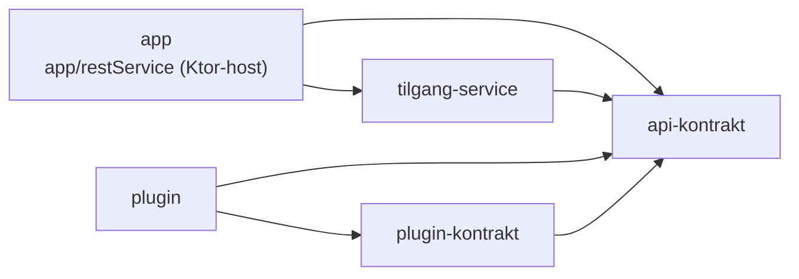

# aap-tilgang
Applikasjon for å sjekke om brukere har tilgang til Kelvin-ressurs.

## Host og tilgangslogikk
Gradle-modulen `app` ligger i `app/restService` og er Ktor-hosten med routes,
konfigurasjon, integrasjoner og adaptere.
`tilgang-service` er biblioteket med tilgangsservice, regler og egne grensesnitt.
Hosten avhenger av biblioteket, ikke omvendt. Biblioteket bruker `api-kontrakt`
for felles roller og operasjoner, men har ingen Ktor-avhengighet.

Rene enhetstester kjøres med `./gradlew :tilgang-service:test`.
HTTP- og adaptertester ligger i `app/restService`; `./gradlew :app:test` kjører disse,
og `./gradlew build` bygger og tester alle modulene.

## Modulavhengigheter

Pilene viser direkte Gradle-avhengigheter fra modulen som bruker et bibliotek
til biblioteket. Eksterne biblioteker og byggeoppsett er utelatt.

## Plugin
For integrasjon mot tilgang-tjenesten finnes det en plugin og en http-klient, se [plugin/README.md](plugin/README.md) 

## Komme i gang
Bruker gradle wrapper, så bare klon og kjør `./gradlew build`

### Lokal kjøring
Prosjektet inneholder en run config som kan kjøres av IntelliJ. Burde være synlig under "Run configurations" med navnet
`dev-gcp.run.xml`.

For at det skal kjøre lokalt må du gjøre følgende:
1. Hent secret med [aap-cli/get-secret.sh](https://github.com/navikt/aap-cli): \
   `get-secret` \
2. Start container med redis/valkey: \
   `docker-compose up -d`
4. Kjør `dev-gcp` fra IntelliJ.

Etter dette vil appen kjøre mot dev-gcp fra lokal maskin. 
Her kan du velge om du vil koble deg på gjennom autentisert frontend eller f.eks. gyldig token med cURL e.l.

OBS: Krever at du har `EnvFile`-plugin i IntelliJ.

### Github package registry
Miljøvariabelen `GITHUB_TOKEN` må være satt for å hente dependencies fra Github Package Registry.

Den skal være satt til din github personal access token.
Denne opprettes på Github ved å gå til settings -> developer settings. 
Husk `read:packages`-rettighet og enable SSO.

## Henvendelser
Spørsmål knyttet til koden eller prosjektet kan stilles som issues her på GitHub

# For NAV-ansatte
Interne henvendelser kan sendes via Slack i kanalen #ytelse-aap-værsågod.
