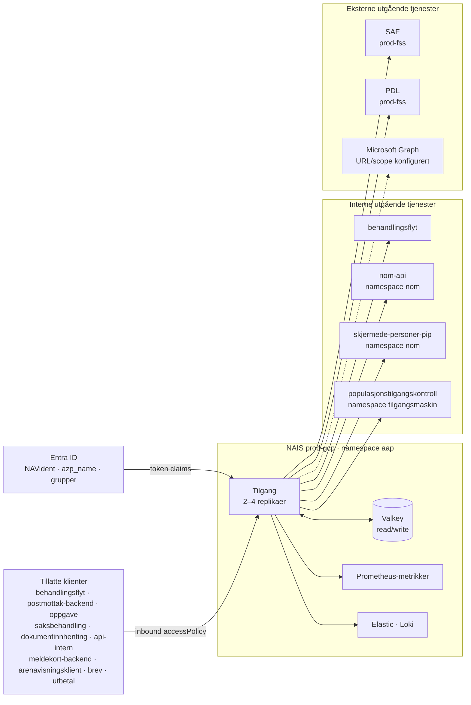
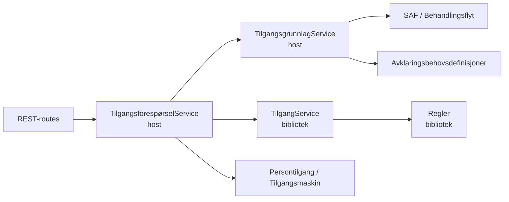
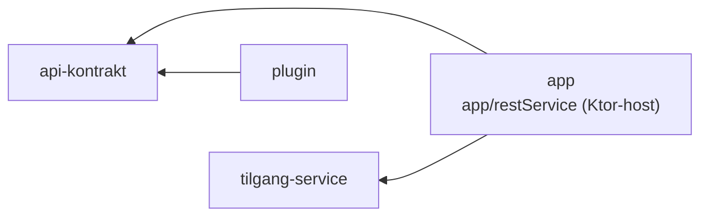

# aap-tilgang
Applikasjon for å sjekke om brukere har tilgang til Kelvin-ressurs.

## Host og tilgangslogikk
Gradle-modulen `app` ligger i `app/restService` og er Ktor-hosten med routes,
konfigurasjon, integrasjoner og adaptere.
`tilgang-service` er biblioteket med tilgangsservice, regler og egne grensesnitt.
Hosten avhenger av biblioteket og av `api-kontrakt`. Biblioteket og kontrakten
kjenner ikke hverandre: biblioteket har egne typer for `Rolle`, `Operasjon` og
`RelevanteIdenter`, og ingen Ktor-avhengighet. Hosten mapper mellom kontrakt-
og bibliotektyper i `tilgang.mapping`.

`TilgangsforespørselService` i hosten samordner ressursforespørslene.
`TilgangsgrunnlagService` henter ident- og journalpostdata sentralt gjennom
hostens egne grensesnitt og oversetter avklaringsbehovskoder til rollekrav.
Bibliotekets `TilgangService` eier regelmotoren, mottar ferdig
`Tilgangsgrunnlag` og returnerer `Map<Operasjon, Boolean>`.
Direkte person- og bulktilgang ligger i REST-fasaden, uten en kunstig operasjonsnøkkel.
Regelmotorens oppslag for adressebeskyttelse og personkontroll er fortsatt beholdt.
`App.kt` kobler sammen komponentene; biblioteket avhenger ikke av grunnlagsinnhentingen.

## Tilgang i produksjonsøkosystemet

Diagrammet viser plasseringen til Tilgang slik den er konfigurert i
[`.nais/prod-gcp.yaml`](.nais/prod-gcp.yaml). Det viser tillatte forbindelser fra
manifestets `accessPolicy`, ikke alle mulige kall fra applikasjonskoden.

Manifestet oppgir eksplisitte eksterne `accessPolicy`-regler for SAF og PDL.
Microsoft Graph er konfigurert i miljøvariablene, men er ikke oppført under
`accessPolicy.outbound.external` i dette manifestet.

Grunnlaget inneholder kallkontekst, søker- og barnidenter, ferdige rollekrav og
ønskede operasjoner. Regelresultater gjenbrukes bare innenfor samme vurderingskall.
REST-svarene er uendret; ordinære avslag gir fortsatt HTTP 200 med `tilgang=false`.
Hosten bruker `org.slf4j.Logger` direkte. Biblioteket har ingen logging-avhengighet.

Kjente roller defineres av `Rolle` i `api-kontrakt`, og gruppe-ID-er leses fra
`AAP_<ROLLENAVN>` gjennom `configForKey`, uten en egen hardkodet rolleliste.
En ny rolle må også legges til i bibliotekets `Rolle` og i mappingen;
mappingen bruker uttømmende `when`, så bygget feiler hvis en kontraktverdi mangler.
Bare roller med konfigurert verdi lastes. Manglende verdier utelater rollen;
en konfigurert verdi må være en gyldig UUID, ellers stopper oppstarten.

Alle modulene bruker Gradles standardmapper: `src/main/kotlin`,
`src/main/resources`, `src/test/kotlin` og `src/test/resources`.

I `tilgang-service/src/main/kotlin` ligger `TilgangService.kt` direkte i roten.
Øvrige filer er gruppert i `input`, `modeller`, `regler` og `exceptions`.
Det felles pakkeprefikset er utelatt fra katalogstiene; pakkene er fortsatt
`tilgang.kontroll` og `tilgang.kontroll.regler`. Testene følger samme flate
grunnstruktur i `src/test/kotlin`.

OpenAPI-kontrakten for REST-endepunktene og driftsrutene ligger i
[contracts/openapi.yaml](contracts/openapi.yaml).

Bibliotekets enhetstester kjøres med `./gradlew :tilgang-service:test`.
Orkestrerings-, HTTP- og adaptertester ligger i `app/restService`; `./gradlew :app:test` kjører disse,
og `./gradlew build` bygger og tester alle modulene.

## Modulavhengigheter

Pilene viser direkte Gradle-avhengigheter fra modulen som bruker et bibliotek
til biblioteket. Eksterne biblioteker og byggeoppsett er utelatt.

## Plugin
For integrasjon mot tilgang-tjenesten finnes det en plugin og en http-klient, se [plugin/README.md](plugin/README.md) 

## Komme i gang
Bruker gradle wrapper, så bare klon og kjør `./gradlew build`

### Lokal kjøring
Prosjektet inneholder en run config som kan kjøres av IntelliJ. Burde være synlig under "Run configurations" med navnet
`dev-gcp.run.xml`.

For at det skal kjøre lokalt må du gjøre følgende:
1. Hent secret med [aap-cli/get-secret.sh](https://github.com/navikt/aap-cli): \
   `get-secret` \
2. Start container med redis/valkey: \
   `docker-compose up -d`
4. Kjør `dev-gcp` fra IntelliJ.

Etter dette vil appen kjøre mot dev-gcp fra lokal maskin. 
Her kan du velge om du vil koble deg på gjennom autentisert frontend eller f.eks. gyldig token med cURL e.l.

OBS: Krever at du har `EnvFile`-plugin i IntelliJ.

### Github package registry
Miljøvariabelen `GITHUB_TOKEN` må være satt for å hente dependencies fra Github Package Registry.

Den skal være satt til din github personal access token.
Denne opprettes på Github ved å gå til settings -> developer settings. 
Husk `read:packages`-rettighet og enable SSO.

## Henvendelser
Spørsmål knyttet til koden eller prosjektet kan stilles som issues her på GitHub

# For NAV-ansatte
Interne henvendelser kan sendes via Slack i kanalen #ytelse-aap-værsågod.
